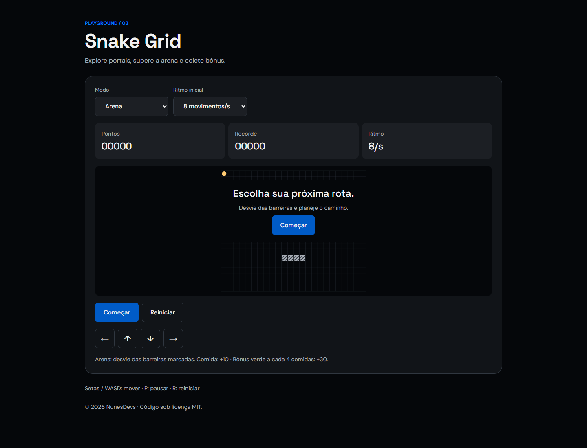
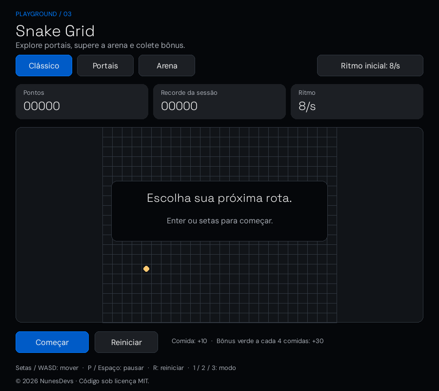

# Snake Grid

Snake para navegador e desktop Python/Pygame, com **Clássico, Portais e Arena**. As interfaces usam a identidade NunesDevs, fontes locais e componentes planejados no Figma.

## Como jogar

- **Clássico:** evite as paredes e o próprio corpo.
- **Portais:** atravesse uma borda para reaparecer no lado oposto; o corpo continua sendo um obstáculo.
- **Arena:** contorne as barreiras fixas e preserve sua rota.
- Comida vale **10 pontos** e aumenta o corpo imediatamente. A cada quatro comidas pode nascer um bônus verde de **30 pontos**, que não aumenta o corpo.
- Altere o ritmo inicial entre 6, 8 e 12 movimentos por segundo. Ele cresce com a pontuação até o limite de 20.

A comida e o bônus nascem em células livres. Uma única mudança de direção é aceita por movimento, sem inversão imediata. As barreiras mantêm corredores conectados; grades pequenas de teste omitem barreiras para preservar o início. Completar o tabuleiro encerra a partida sem loop de geração de comida.

## Demo web

[Abrir Snake Grid](https://nunesdevs.github.io/Snake-Game/) · [Portfólio NunesDevs](https://nunesdevs.nunexx.com.br)

**Setas / WASD** movem; **P / Espaço** pausa; **R** reinicia. Também há botões direcionais e gestos de deslizar. O jogo pausa quando perde foco ou a página fica oculta. Mudar o modo ou ritmo reinicia a partida e preserva o recorde local.

Node.js **24 ou superior**; o runtime não exige instalação de dependências.

~~~sh
node tools/build-web.mjs
python -m http.server 8000 --bind 127.0.0.1 --directory dist
~~~

Abra `http://127.0.0.1:8000`. O build copia apenas **14 arquivos** do runtime, sem aplicativo Python, README ou configuração. Arquivos desconhecidos e pastas vinculadas em `dist/` são recusados antes da escrita e permanecem preservados.

## Aplicativo desktop

Use **Python 3.12** e um ambiente virtual. As wheels do Pygame 2.6.1 estão fixadas por SHA-256 no manifesto para os sistemas compatíveis.

~~~sh
python -m venv .venv
.venv/Scripts/python -m pip install --require-hashes --only-binary=:all: -r requirements.txt
.venv/Scripts/python main.py
~~~

No Linux/macOS, use `.venv/bin/python`. A sessão normal requer uma tela disponível. O aplicativo oferece botões de modo e ritmo, pausa, reinício e recorde da sessão. **1 / 2 / 3** escolhem o modo e **Enter** começa ou alterna a pausa.

O modelo Python é independente de Pygame. A grade inicial, crescimento imediato, fila de direção, colisões, portais e bônus seguem as mesmas regras da versão web. O recorde desktop é mantido na sessão; o navegador conserva seu próprio recorde.

## Validar

~~~sh
node --test tests/*.test.mjs
node --check web/main.mjs
python -m unittest discover -s tests -v
pnpm install --frozen-lockfile --ignore-scripts
pnpm exec playwright install chromium
pnpm run test:e2e
python tools/capture-desktop.py --mode arena --output reports/visual/desktop-arena.png
~~~

A captura desktop executa a interface real com o driver SDL de teste, sem abrir uma janela visível; não representa uma sessão manual com hardware. A CI usa Windows e Linux, Python 3.12 e Chromium.

Validação local de 15/11/2026: **21 testes Node**, **13 testes Python**, **7 fluxos Playwright**, oito larguras de **320 a 1920 px**, sem overflow ou erros de JavaScript, console, rede e HTTP. Os testes verificam comida alcançada por entradas reais, travessia de portais, colisão, reinício, toque, arena e iframe isolado. Duas capturas SDL reais e `pip check` também passaram.

## Estrutura e licença

`web/engine.mjs` e `game/model.py` contêm modelos puros; `web/main.mjs` e `game/game.py` cuidam dos controles e da renderização. A ponte web limita as mensagens de recorde, pausa e altura do iframe e tolera indisponibilidade de armazenamento em origem opaca.

Código próprio sob **MIT**, conforme `LICENSE`. Fontes DM Sans e Space Grotesk têm suas licenças OFL em `web/assets/fonts/` e `game/assets/fonts/`; a origem e os hashes das fontes desktop estão em `SOURCES.json`.
